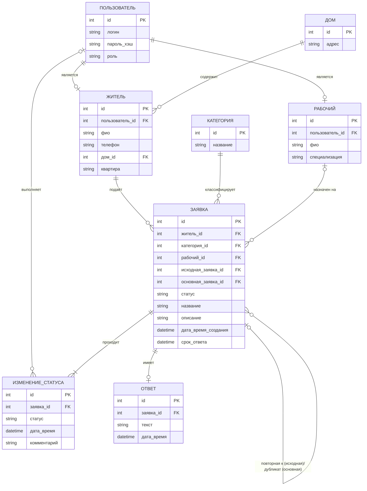

# Концептуальная схема данных «Заявки УК»

- Один пользователь — не более одного жителя или рабочего (1:0..1).
- Один дом — много жителей (1:N).
- Один житель — много заявок (1:N).
- Одна категория — много заявок (1:N).
- Один рабочий — много назначенных заявок (0..1:N); до назначения рабочий_id пуст.
- Заявка имеет не более одного ответа (1:0..1) — ответ появляется после исполнения.
- Заявка проходит несколько изменений статуса (1:N, не менее одного — создание). Запись ИЗМЕНЕНИЕ_СТАТУСА хранит новый статус и время. В комментарий записывается пояснение, например причина отклонения. Поле статус в ЗАЯВКА — текущий статус (последняя запись истории). Время назначения рабочего и время выполнения не хранятся в заявке, а берутся из записей истории для статусов «Назначена» и «Выполнена».
- Ссылки на другую заявку разделены по виду связи:
  - исходная_заявка_id — повторное обращение: указывает на заявку, результат которой оспорил житель (0..1:N). Исходная заявка получает статус «Оспорена»;
  - основная_заявка_id — дубликат: указывает на основную (первую) заявку по той же проблеме (0..1:N). Дубликат отдельно не исполняется.
- Поле срок_ответа устанавливает администратор при назначении рабочего; срок назначения (3 суток) и срок подтверждения (3 суток) считаются от дата_время_создания заявки и от времени перехода в «Выполнена» соответственно и отдельно не хранятся.

Связь между ответом на заявку и рабочим решил не делать, т.к. по заявке и так ясно, кто прикреплен к ней, и кто ответит. Так же с домом.